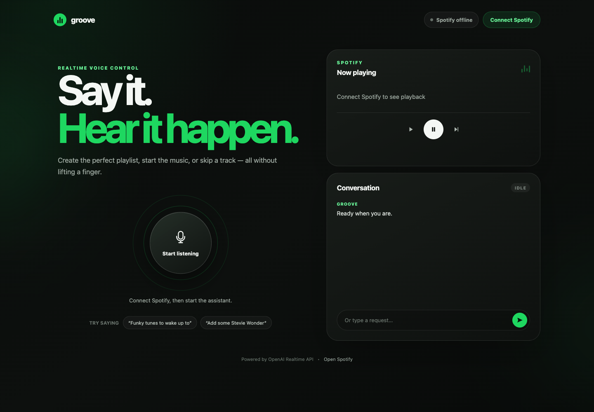

# Groove

**A conversational, realtime voice assistant for Spotify.**

For some reason, Spotify's DJ just won't shut up. You also can't really have a good natter with it about what you feel like hearing.

OpenAI's realtime voice models make a more conversational music assistant possible. Tell Groove you are in the mood for funky rock, name an artist you love and ask for similar bands, or simply say:

> Make me an angry dubstep playlist to code to.

Groove was a small experiment to connect the OpenAI Realtime API to Spotify. It can create private playlists, add or remove songs, and control playback using your voice. Once music starts, Groove switches to push-to-talk—an AI walkie-talkie mode—so lyrics and background music are not mistaken for new commands.

> [!NOTE]
> Groove is an experimental, single-user local app. OpenAI API usage is billed to your OpenAI API account, and Spotify playback control requires Premium. It is not ready to expose directly to the internet.



## What it can do

- Create and immediately play a private playlist from a mood, genre, activity, era, or artist prompt.
- Search for and play a specific song, or resume the active Spotify player.
- Pause playback, skip the current track, and target a named Spotify Connect device.
- Add songs to or remove songs from the most recently created playlist or an explicit playlist ID.
- Show the current track and a live conversation transcript in the browser.
- Switch automatically from voice activity detection to push-to-talk when playback begins.

Try requests such as:

- “Create a playlist of funky rock for a sunny morning.”
- “I love Talking Heads—make me something with a similar energy.”
- “Play Superstition by Stevie Wonder on the kitchen speaker.”
- “Remove that first track and add some Parliament.”
- “Pause the music.”

## How it works

The browser uses WebRTC for low-latency speech-to-speech conversation with OpenAI. A small Express server creates the Realtime session, keeps credentials out of the browser, completes Spotify's Authorization Code flow, and executes a narrow allow-list of Spotify actions.

The assistant exposes six function tools:

| Function | Behaviour |
| --- | --- |
| `create_playlist_and_play` | Resolves up to 12 song searches, creates a private playlist, adds the tracks, and starts it. |
| `play_music` | Resumes playback or searches for and starts one song. |
| `pause_music` | Pauses the selected player; “stop” is treated as pause. |
| `skip_track` | Skips to the next item. |
| `add_songs_to_playlist` | Adds resolved tracks to an explicit playlist or the most recently created one. |
| `remove_songs_from_playlist` | Removes resolved tracks from an explicit playlist or the most recently created one. |

## Requirements

- Node.js 22 or newer. CI verifies Node.js 22 and 24.
- An [OpenAI API key](https://platform.openai.com/api-keys) with access to `gpt-realtime-2.1`.
- A Spotify Premium account and a [Spotify developer application](https://developer.spotify.com/dashboard).
- A modern browser with WebRTC and microphone support.
- An open Spotify client on a phone, computer, or Spotify Connect speaker when playback should begin.

Spotify's current Development Mode rules require the app owner to have Premium and limit new apps to five allow-listed users. See Spotify's [February 2026 migration guide](https://developer.spotify.com/documentation/web-api/tutorials/february-2026-migration-guide) for the current restrictions.

## Quick start

### 1. Install the project

After cloning the repository:

```bash
npm ci
cp .env.example .env.local
```

### 2. Configure OpenAI

Create an OpenAI project API key and add it to the ignored `.env.local` file:

```dotenv
OPENAI_API_KEY=your_openai_api_key
```

The default model and voice are already defined in `.env.example`:

```dotenv
OPENAI_REALTIME_MODEL=gpt-realtime-2.1
OPENAI_REALTIME_VOICE=marin
```

The standard API key is used only by the Node server to initialize a Realtime WebRTC call. It is never returned to browser code.

### 3. Configure Spotify

1. Open the [Spotify Developer Dashboard](https://developer.spotify.com/dashboard) and create an application.
2. Add this exact redirect URI:

	```text
	http://127.0.0.1:3003/auth/spotify/callback
	```

	Spotify permits plain HTTP for explicit loopback IP addresses during local development. `localhost` is not accepted as a redirect URI.
3. Add the app credentials to `.env.local`:

	```dotenv
	SPOTIFY_CLIENT_ID=your_client_id
	SPOTIFY_CLIENT_SECRET=your_client_secret
	SPOTIFY_REDIRECT_URI=http://127.0.0.1:3003/auth/spotify/callback
	```

The app requests only these Spotify scopes:

- `playlist-modify-private`
- `user-modify-playback-state`
- `user-read-playback-state`

### 4. Start Groove

```bash
npm run dev
```

Open [http://127.0.0.1:3003](http://127.0.0.1:3003), then:

1. Select **Connect Spotify** and approve access.
2. Open Spotify on the device where you want music to play.
3. Select **Start listening** and allow microphone access.
4. Speak a request.

After music starts, the main control becomes **Hold to talk**. Hold it for the full request and release it when finished. The microphone is muted between turns. The text field is available as a fallback while a Realtime session is connected.

## Configuration

| Variable | Required | Default | Purpose |
| --- | --- | --- | --- |
| `OPENAI_API_KEY` | Yes | — | Server-side OpenAI project API key. |
| `SPOTIFY_CLIENT_ID` | Yes | — | Spotify developer application client ID. |
| `SPOTIFY_CLIENT_SECRET` | Yes | — | Spotify developer application client secret. |
| `OPENAI_REALTIME_MODEL` | No | `gpt-realtime-2.1` | Realtime model used for the voice session. |
| `OPENAI_REALTIME_VOICE` | No | `marin` | Realtime output voice. |
| `PORT` | No | `3003` | Local HTTP port. |
| `APP_BASE_URL` | No | `http://127.0.0.1:3003` | Browser origin and OAuth callback base. |
| `SPOTIFY_REDIRECT_URI` | No | `<APP_BASE_URL>/auth/spotify/callback` | Exact redirect URI registered with Spotify. |
| `SPOTIFY_TOKEN_PATH` | No | `.spotify-tokens.json` | Local Spotify OAuth token store. |

## Security and privacy

- `.env.local`, other local environment files, and `.spotify-tokens.json` are ignored by Git.
- The OpenAI API key, Spotify client secret, and Spotify OAuth tokens remain on the Node server.
- Spotify OAuth uses a one-time state value and an `HttpOnly`, `SameSite=Lax` cookie.
- Spotify access tokens refresh automatically and are persisted with owner-only file permissions.
- Tool names are allow-listed, arguments are validated, and the model cannot choose an arbitrary Spotify endpoint.
- Song search phrases are sent to Spotify. Compact tool outcomes are returned to the Realtime conversation; raw Spotify catalogue responses are not.
- Conversation text is rendered in the current browser page and is not persisted by this application.
- The server binds to `127.0.0.1` and rejects cross-origin browser mutations.

See [SECURITY.md](SECURITY.md) before adapting the project for a networked or multi-user deployment.

## Known limitations

- Groove controls an existing Spotify client; it does not stream Spotify audio itself.
- Song matching uses Spotify's first search result, so ambiguous requests can select the wrong recording.
- The “most recently created playlist” shortcut is held in memory and resets when the server restarts.
- Playlist creation is private by design, and at most 12 requested tracks are resolved per tool call.
- This is a local single-user experiment without application accounts, multi-user token isolation, or production rate limiting.

## Development

Run all release checks:

```bash
npm run ci
```

Or run them separately:

```bash
npm run check
npm test
```

The test suite uses fakes rather than live credentials. It locks in the Realtime session/tool contract and Spotify's current `POST /me/playlists` and `/playlists/{playlist_id}/items` endpoints.

See [CONTRIBUTING.md](CONTRIBUTING.md) for code style, testing, documentation, and pull request expectations.

## API references

- [OpenAI Realtime API with WebRTC](https://developers.openai.com/api/docs/guides/realtime-webrtc)
- [OpenAI Realtime conversations](https://developers.openai.com/api/docs/guides/realtime-conversations)
- [OpenAI Realtime function tools](https://developers.openai.com/api/docs/guides/realtime-mcp)
- [Spotify Authorization Code flow](https://developer.spotify.com/documentation/web-api/tutorials/code-flow)
- [Spotify redirect URI requirements](https://developer.spotify.com/documentation/web-api/concepts/redirect_uri)
- [Spotify create playlist](https://developer.spotify.com/documentation/web-api/reference/create-playlist)
- [Spotify add playlist items](https://developer.spotify.com/documentation/web-api/reference/add-items-to-playlist)
- [Spotify remove playlist items](https://developer.spotify.com/documentation/web-api/reference/remove-items-playlist)
- [Spotify player endpoints](https://developer.spotify.com/documentation/web-api/reference/start-a-users-playback)

## Licence

Released under the [MIT Licence](LICENSE).

Spotify and OpenAI are trademarks of their respective owners. Groove is an independent experiment and is not affiliated with, sponsored by, or endorsed by Spotify or OpenAI.
